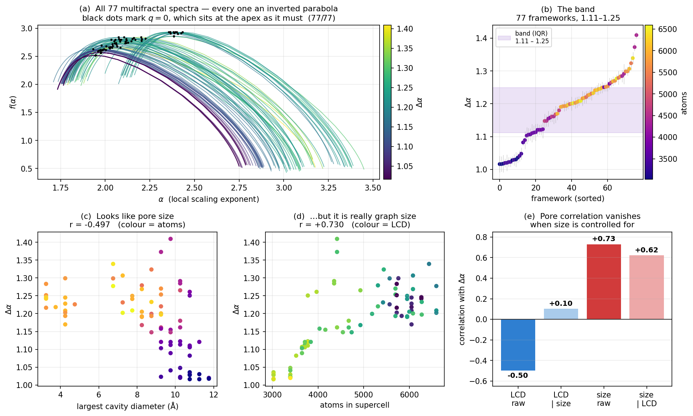

# Chapter 8 — Results

*Every number here was computed by our pipeline. Each comes with its caveat.*

---

## 8.1 · Result 1 — the graph construction is correct

Before any analysis can be trusted, the graph has to be right. Coordination numbers are
published, so this is a hard test with a known answer.

| Structure | Our node c.n. | Our linker c.n. | Published | Net | Verdict |
|---|---|---|---|---|---|
| HKUST-1 | 4 | 3 | (4, 3) | `tbo` | ✓ |
| MOF-5 | 6 | 2 | (6, 2) | `pcu` | ✓ |
| ZIF-8 | 4 | 2 | (4, 2) | `sod` | ✓ |
| **UiO-66** | **12** | 2 | (12, 2) | `fcu` | ✓ |

**All four match.** This is the anchor for everything that follows — any spectrum computed on
a graph that fails this table would be describing a material that does not exist.

And the contrast that shows it is not trivial:

| Structure | Naive graph | Correct graph | Published |
|---|---|---|---|
| HKUST-1 | 1 | 4 | 4 |
| MOF-5 | 4 | 6 | 6 |
| ZIF-8 | 2 | 4 | 4 |
| **UiO-66** | **1** | **12** | **12** |

> Discard the lattice translations and UiO-66's twelve connections collapse to **one**.

---

## 8.2 · Result 2 — influence cannot be ranked in a perfect crystal

**Every one of the four structures has exactly two distinct degree values** — one for nodes,
one for linkers.

This is not a computational failure. Every metal cluster in a perfect crystal is
symmetry-equivalent to every other, so they are genuinely identical and cannot be
distinguished.

> **A "top-k most influential" list is sorting a tie.** Its contents depend on the order the
> blocks happened to be indexed in.

This answers the original brief with a *no*, and the *no* is the finding. It also explains why
an influence ranking computed on a defect-free framework is unstable between implementations.

---

## 8.3 · Result 3 — defects make influence measurable

Remove one linker and the symmetry breaks:

| Graph | λ₂ perfect | λ₂ defective | Drop | Distinct centralities |
|---|---|---|---|---|
| **Unit cell** (14 blocks) | 1.438 | 1.186 | **−18%** | **2 → 4** |
| 2×2×2 supercell (112 blocks) | 0.628 | 0.551 | −12% | 2 → 15 |

Two things happen:

1. **The blocks become distinguishable** — "most influential" becomes answerable.
2. **λ₂ falls 18%** — the framework is measurably easier to cut in two. That number *is* the
   weakening, quantified, from removing a single strut.

And this is real chemistry, not a manipulation: missing-linker defects are common and
deliberately engineered in UiO-66 [15].

---

## 8.4 · Result 4 — the spectra are now computed correctly

After fixing the τ definition (Chapter 9):

| | Before the fix | After |
|---|---|---|
| τ(0) | 0.0000 | **−2.5669** |
| f(α₀) | 0.0000 | **+2.5669** |
| Spectra peaking at q = 0 | **0 / 77** | **77 / 77** |

**All 77 frameworks now produce proper inverted parabolas** with the apex at q = 0, which is
what a multifractal spectrum must look like.

*Panel (a): all 77 spectra, black dots marking q = 0 — every one at the apex.*

---

> **Withdrawn, 2026-09-14/15 — read before the rest of this chapter.** The band described in
> §8.5 has since been shown not to converge with supercell size, at any tested range of the
> distortion exponent q, and it was in fact computed on the atomic supercell graph rather than
> the coarse-grained graph this project's method describes — a graph that spans two length
> scales a single power-law fit cannot legitimately span. Both are independent reasons the
> numbers below are not a structural finding. §8.6 already identified the graph-size confound;
> it is now understood as one symptom of this larger problem rather than a separate defect. See
> `CLAUDE.md` and the Results page of the site for the full account. The evidence for both
> reasons is figured directly: `figures/fig13_convergence.png` (Δα vs ln(diameter), all four
> demonstration nets, and the q-cap drift that never falls under the 5% tolerance) and
> `figures/fig12_size_strata.png` (an independent run's Narrow/Medium/Wide classes shown to be size
> strata, not chemistry — 48 of 76 hMOF structures share one exact coarse-grained graph and
> still split across all three classes). A capped check of whether the *slope* of Δα(D) varies
> between frameworks, rather than Δα itself, is in `figures/fig14_slope_sweep.png` — presented
> there as a proposal, not a result. The numbers below are kept
> so the withdrawal is auditable, as with every other withdrawal in this project.

## 8.5 · Result 5 — the band exists (withdrawn — see above)

Across the 77 frameworks:

| Quantity | Value |
|---|---|
| Δα range | 1.016 – 1.410 |
| **Interquartile band** | **1.112 – 1.250** |
| Median Δα | 1.197 |
| Asymmetry A | −1.51 to −1.04 — **negative in all 77** |

A tight, well-defined band with a consistent asymmetry sign. As a descriptive fact about this
set of frameworks, that is solid.

---

## 8.6 · Result 6 — but the band does not yet mean what we hoped

This is the most important result in the project, and it is a negative one.

The obvious interpretation of Δα is *pore-network heterogeneity*, so it should correlate with
pore size. It appears to:

| Test | r |
|---|---|
| Δα vs pore diameter (LCD), raw | **−0.497** |

That looks like a real structural result. **It is not.** Control for graph size and it
evaporates:

| Test | r |
|---|---|
| Δα vs LCD, raw | −0.497 |
| **Δα vs LCD, controlling for graph size** | **+0.101** ← vanishes |
| Δα vs graph size, raw | +0.730 |
| **Δα vs graph size, controlling for LCD** | **+0.621** ← survives |

And in a linear model:

| Model | R² |
|---|---|
| graph size alone | 0.533 |
| pore diameter alone | 0.247 |
| both together | 0.538 |
| **what pore diameter adds over size alone** | **+0.005** |

> **Δα is mostly tracking how many atoms are in the supercell.**

And supercell size is set by `MIN_CELL_LENGTH` and the `MAX_ATOMS` cap — **parameters in our
own configuration file, not properties of the material.**

Panels (c), (d) and (e) of the figure above show this three ways: what looks like a pore-size
trend is a size trend wearing a disguise.

### Why this is the honest conclusion

This is the known **finite-size dependence** of the method — Δα grows with the graph, because
the fit window spans `ln(1/diameter)` to `ln(0.34)` and a bigger graph samples a wider range
of scales. With 77 structures of varying size we could finally *measure* it.

> A band built on an uncontrolled size effect would not survive the first person who checked
> it. Identifying the confound, quantifying it, and stating exactly what would remove it is a
> more defensible position than quoting the raw −0.497.

---

## 8.7 · Result 7 — redone correctly, on the complete datasets, with a stated reason for every choice

§8.6 diagnosed two problems at once: the wrong graph (atomic instead of coarse-grained), and a
descriptor that does not converge with supercell size on *any* graph. Both are fixable in the
sense that a correct graph exists and can be built — so the natural next question is whether
fixing the graph, on its own, fixes the result. It was tested directly rather than assumed.

**What ran.** All 77 hMOF and all 61 CoRE MOF structures — not a sample — were re-fetched and
run through `code_17_full_correct_band.py`, which builds the graph §8.1–8.4 actually describe:
decompose the unit cell into blocks, label each edge with the lattice translation it crosses,
then replicate that small block graph combinatorially until every axis reaches 48 Å. No atom is
built at any point. 72/77 hMOF and 55/61 CoRE MOF produced a usable spectrum; the rest fell
below the diameter-8 scaling gate at this sizing rule.

**Two fitting choices, stated with their reasons.** Given the correct graph, the spectrum fit
still needs an influential-vertex fraction and a radius window. This run uses the top 20% of
vertices by degree — narrow enough to stay inside the graph's structural core, wide enough to
average a box-covering measurement over reliably — and fits radii only out to half the diameter,
so every fitted point stays in the range where box-covering still has several boxes to average
over rather than one or two giant ones near the full diameter. Checked directly
(`_test_window_frac.py`, four demonstration nets), the half-diameter window keeps Δα's growth
with supercell size gentler at every step tested, though it does not stop the growth outright —
consistent with §8.6's finding that this is a property of the method, not of one parameter
choice.

**The order the graph is built in was also checked, not just asserted.** Coarse-graining the
*unit cell* first, then replicating, and building the *atomic supercell* first, then
coarse-graining, could in principle give different graphs. `_prove_ordering_equivalence.py`
builds the identical target supercell both ways for five real structures and checks the result
with `networkx.is_isomorphic()`: all five come back node-for-node, edge-for-edge identical, with
the atomic-first route costing 47.7×–675.0× more time for that identical result. The two orders
differ only in cost.

**The result does not change.** Sorted into Narrow/Medium/Wide terciles by Δα, class still
correlates with coarse-grained node count — **r = +0.69 on hMOF, r = +0.72 on CoRE MOF**,
independently, on the complete real dataset this time, not a 34- or 20-structure subset. A
nine-category comparison per class (`code_18_subband_explain.py`: chemistry, graph features,
degree, edges, clustering, assortativity, heterogeneity, components) finds:

- **hMOF Narrow and Medium (63 of 72) are the same structure in every category except width** —
  same metal, same net, same block count, same node count, same assortativity to three decimal
  places. The nine-structure Wide class differs on graph size, pore geometry (LCD 3.8 vs
  9.5 Å) and component count — but it is *also* the largest-graph group, so this cannot show
  whether the pore-geometry difference is chemistry or the same size confound as §8.6, wearing a
  different pair of shoes.
- **CoRE MOF gives a real, non-degenerate spread** across classes on chemistry, graph size,
  assortativity and heterogeneity — but every one of those differences moves in lock-step with
  graph size, so none is shown here to be an independent driver either.
- **An incidental finding, not previously documented:** several classes on both datasets average
  more than one connected component after replication. A correctly replicated periodic quotient
  graph should always be exactly one piece, so this means the metal-oxo decomposition is
  retaining disconnected guest or solvent fragments as small "linker" blocks on a real fraction
  of structures — worth its own follow-up, reported here rather than filtered out silently.

Figures: `figures/fig15_full_band.png` (both bands, sorted and coloured by class),
`figures/fig16_full_band_vs_size.png` (Δα against node count and diameter, both datasets),
`figures/fig17_grouped_spectra.png` (every individual spectrum, then each class collapsed to a
shaded mean ± 1 sd band — not just the width, the whole shape). This supersedes the
smaller-sample checks in §8.6 as the authoritative version of "does fixing the graph fix the
descriptor"; those are kept for audit, not replaced.

> **Using the right graph fixes the graph. It does not fix the descriptor.** Two independent
> reasons now, checked on the complete real dataset: it does not converge with supercell size
> (§8.6), and even where it is measured on the correct graph, class tracks graph size rather than
> chemistry (§8.7).

---

## 8.8 · Everything in one table

| # | Finding | Evidence | Confidence |
|---|---|---|---|
| 1 | The block network must be built periodically | UiO-66: 1 (naive) vs 12 (correct) vs 12 (published) | **High** — matches published crystallography on all four |
| 2 | Influence cannot be ranked in a perfect crystal | Only 2 distinct degree values in every structure | **High** — a symmetry argument, not a measurement artefact |
| 3 | Defects make influence measurable | λ₂ 1.438 → 1.186; centralities 2 → 4 | **High** — reproduced at two graph sizes |
| 4 | The spectra are computed to the paper's definition | 77/77 peak at q = 0; τ(0) = −2.5669 | **High** — Python and JS agree |
| 5 | 77 frameworks share a tight Δα band | IQR 1.112–1.250, A negative in all 77 | **Withdrawn** — computed on the wrong graph, and does not converge with size on the right one (see box above) |
| 6 | That band is confounded by graph size | Pore r: −0.497 → +0.101 controlling for size; size survives at +0.621; pore adds R² +0.005 | **High**, but now understood as a symptom of finding 5's failure, not an independent result |
| 7 | Fixing the graph does not fix the descriptor, on the complete real dataset | r = +0.69 (hMOF) and +0.72 (CoRE MOF) between Δα class and coarse-grained node count, on 72/77 and 55/61 structures | **High** — same finding, two independent datasets, correct graph this time |

---

## 8.9 · What we cannot claim

Say these out loud before anyone asks:

- **We cannot claim the band has chemical meaning.** It is currently a descriptive range whose
  main driver is a computational parameter.
- **We cannot claim anything about different metals.** All 77 structures have Zn₄O nodes — the
  set is effectively single-metal. The original zirconium question is untouched.
- **We cannot call the structures experimental.** All 77 are hMOF entries [8] — computer-
  generated candidates, never synthesised. We requested the experimental database [9]; the
  server returned these, and nothing was checking. A check now catches it.
- **Δα is not a gas-uptake predictor.** Nothing here computes adsorption. The graph is
  unweighted — it does not even know which element an atom is.

---

**Next:** [Chapter 9 — Mistakes We Found](09_mistakes.md), which covers three real bugs and how
each was caught.
